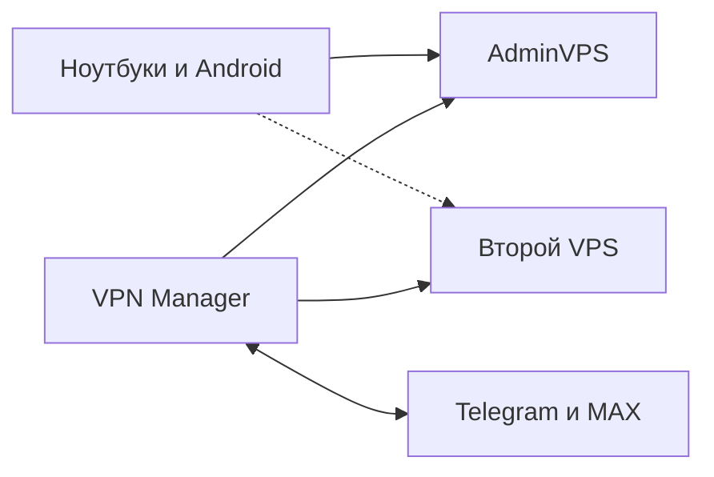

# Личный VPN

VPN Manager управляет личными VPN-узлами. Через него можно проверить сеть,
посмотреть заказы, запустить контейнеры и получать алерты в Telegram и MAX.
Рабочий AdminVPS пока использует 3x-ui. Для нового VPS есть сценарий развёртывания Xray.



## Быстрый старт в Windows cmd

```cmd
cd /d D:\Development\vpn
uv sync --locked --link-mode copy
uv run vpn-manager
```

Без команды в терминале открывается меню. Стрелки и Enter выбирают пункт, Esc
возвращает назад. Правила написания кода и команды проверок лежат в [AGENTS.md](AGENTS.md).

- [Развёртывание VPN и управление контейнерами](deploy/README.md)
- [План новой версии, синхронизация и восстановление](docs/README.md)
- [Мониторинг, боты и проверки через российскую сеть](ops/README.md)
- [AdminVPS, Fornex и OneDash](ops/providers.md)
- [Аварийный профиль на случай белых списков](ops/allowlist.md)

Локальный `.env` содержит доступы и настройки ролей. Пример параметров ботов и API
лежит в [.env.example](.env.example). Для нового VPN-узла используйте отдельный
`.env.deploy`, созданный из [.env.deploy.example](.env.deploy.example).
